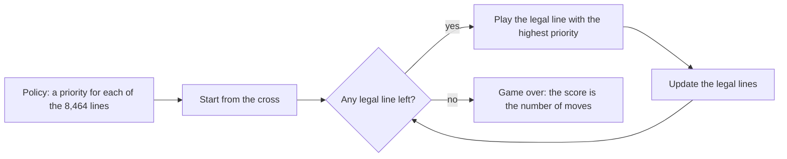
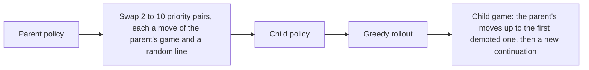
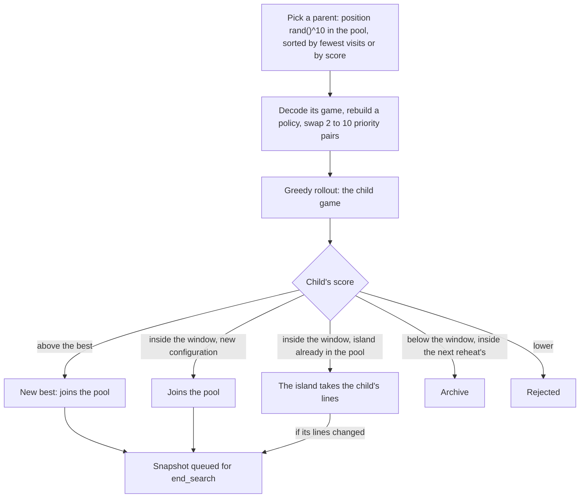
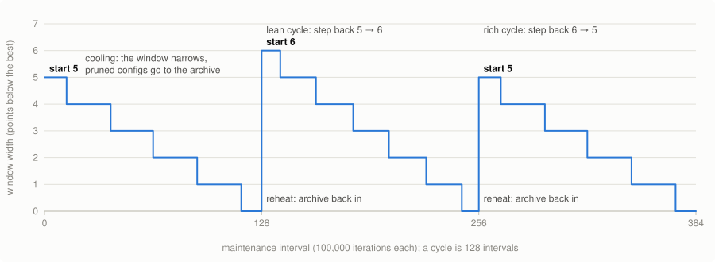
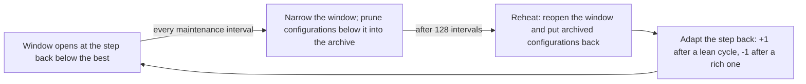
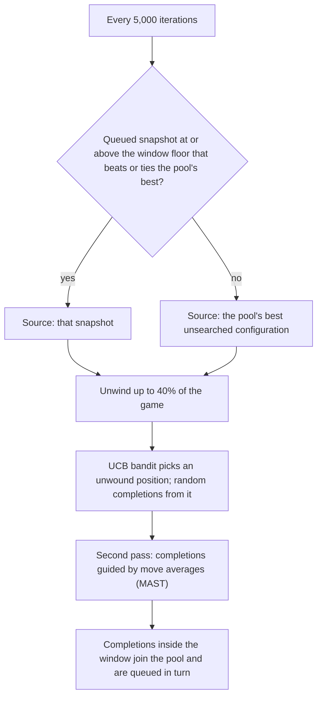

# Morpion Solitaire 5T search in Julia

A search for long games of [Morpion Solitaire](http://www.morpionsolitaire.com/), 5T variant. It is a simulated-annealing-style search over **move-preference policies**: each candidate game is a ranking of every possible line, the game it plays is the greedy rollout of that ranking, and a population of rankings is evolved under an acceptance window that cools towards the best score and periodically reheats.

The 5T record is 178 moves (Christopher Rosin, 2011, nested rollout policy adaptation). This search has found several 178s: all are variants of Rosin's grid, and one differs from it by 11 dots and 71 lines. Every game of 170 or more that it has found is listed at the top of [`population.jl`](population.jl).

The code is in two files:

- [`population.jl`](population.jl): the search (`main`).
- [`morpion.jl`](morpion.jl): the game engine.

The experimental record behind every setting is in [`RESEARCH.md`](RESEARCH.md).

## Quick start

Requires Julia 1.11 or later.

```sh
julia --project=. -e 'using Pkg; Pkg.instantiate()'   # first time only
julia --project=. population.jl                        # run the search until interrupted
julia --project=. test/runtests.jl                     # run the tests
```

From the REPL you can set a budget and any option:

```julia
include("population.jl")
cs = main(max_seconds=3600)                     # one hour
c = cs[1]
c.max_score, generate_pack(c.max_moves)         # best score and its pack
main(max_seconds=600, trace=10)                 # sample 10 rollouts per maintenance interval
main(max_seconds=600, stats=SearchStats(rows=false), verbose=false)   # instrumented, quiet
```

A run is single-threaded. Long runs are the point: scores keep improving for hours, and the settings are tuned for runs of 24 hours or more. To use several cores, run independent processes with different seeds.

## How the search works

### A game as a move-preference policy (the "DNA")

On the 46 × 46 board there are 46 × 46 × 4 = 8,464 possible lines: a dot plus a direction. A policy (`perm`, the "DNA") gives every one of them a priority. The game it plays is fully determined by that ranking. From the starting cross, it repeatedly plays the legal line with the highest priority until no move is left (`eval_dna_and_hash!` in `morpion.jl`, about 100 ns per move).

Changing a policy changes its game. A **modification** swaps the priorities of a few pairs of lines: by default 2–10 swaps, each pairing a move of the parent's game with a random line. When a demoted move stops being first choice, the rollout diverges from the parent's game there and plays on greedily.





A policy never needs to be stored. Given a game, `dna_from_moves!` rebuilds a policy that replays it exactly. So the pool stores games, not rankings: each pool entry (`Perm`) is about 88 bytes, holding the game as a bit-packed set of lines (`PackCodec`).

### The population and the annealing window

Each candidate keeps a **pool** of distinct configurations. A configuration is identified by its set of dots (`config_key=:points`). Games that place the same dots with different lines form one *island*, which keeps whichever line set was seen most recently.

Every iteration:

1. **Pick a parent.** Every 100,000 iterations the pool is re-sorted, alternating between fewest visits first and highest score first (`sort_rotation=:alternate`). The parent's position is drawn as `rand()^selection_skew` with skew 10, which strongly favours the front of the pool.
2. **Mutate it and roll the child out.**
3. **Accept or reject the child.**
   - A child that beats the best score is the new best.
   - A new configuration scoring within the **acceptance window**, at least `max − back_accept`, joins the pool.
   - A child that lands on an island already in the pool refreshes that island's lines.
   - Anything else is rejected.



The acceptance window plays the role of the annealing temperature: how far below the best a configuration may score and still be kept. With `window_schedule=:timer` it follows a fixed schedule:

- **Cooling:** over a cycle of 128 maintenance intervals (each 100,000 iterations), the window narrows from `window_start` (5) below the best down to the best itself, following `window_start × (1 − k/128)^window_shape` (shape 1, so linearly). The search starts each cycle exploring broadly and ends it concentrating on the best islands.
- **Pruning into the step-back cache:** as the window narrows, configurations that fall below it are moved out of the pool into an **archive** (up to 1,000,000 perms). Children that score below the current window but would fit the next, wider one are archived as well (`archive_rejects`).
- **Reheating:** at the end of a cycle the window reopens to `window_start`, and every archived configuration inside it goes back into the pool.
- **Adaptive step back:** after each cycle, `window_start` widens by 1 if the cycle produced fewer than `window_adapt_target` new configurations, and narrows by 1 otherwise (within 0–30).





Acceptance is a deterministic threshold, not a Metropolis probability, so in the annealing family it is closest to threshold accepting or record-to-record travel, with a cyclic cooling-and-reheating schedule.

### end_search: completing games from earlier positions

Every 5,000 iterations, `end_search` takes one configuration, unwinds up to 40% of its game, and plays many random completions from those earlier positions. Every distinct completion that lands inside the window is added to the pool.

- **How the completions are spent** (`es_mode=:ucb_then_mast`):
  - a UCB bandit chooses which unwound position to complete from;
  - a second pass draws completions from move-average statistics (MAST).
  - Each pass stops after a stall without new results.
- **What gets searched** is taken from an **end_search queue**:
  - **What's queued:** snapshots of every new best, every accepted child, every line change of an island, and every end_search result entering the pool.
  - **What's taken first:** the highest-scoring unsearched snapshot at or above the window floor.
  - **Fallback:** if nothing in the queue qualifies, the best unsearched pool configuration is used.
  - **Memory of what's been searched:** kept by line set (`es_searched_key=:lines`), so an island whose lines have drifted is searched again.



### Recorded games

The comment lines at the top of `population.jl` (`# <score> <pack>`) list every game of 170 or more found so far, sorted by score and then by pack. A pack is a compact text encoding of a game's lines (`generate_pack`). To get the moves back:

```julia
include("population.jl")
moves = unpack_pack("ZEhMTa5SEJgWSnjJ2kY3rrRPq/sn++zevl6DtNszde9n63f+6+44").moves
length(moves)   # 178
```

## Main options

All options are keyword arguments of `main`. The defaults are the current tuned values; [`RESEARCH.md`](RESEARCH.md#current-state) records why each one is set as it is and when it changed.

| Group | Options (default) |
|---|---|
| Budget and output | `max_iterations` (none), `max_seconds` (none), `verbose` (true), `trace` (0), `stats` (`nothing`), `debug_interval` (100,000), `print_interval` (100,000) |
| Mutation and selection | `min_modifications`/`num_modifications` (2/10), `selection_skew` (10), `sort_rotation` (`:alternate`), `initial_perms_size` (100) |
| Annealing window | `window_schedule` (`:timer`), `window_cycle` (128), `window_start` (5), `window_shape` (1), `window_dwell` (0), `window_adapt` (true), `window_adapt_target` (10,000), `window_adapt_step` (1), `window_adapt_min`/`window_adapt_max` (0/30) |
| Archive (step-back cache) | `archive_size` (1,000,000), `archive_rejects` (true) |
| end_search | `end_search_interval` (5,000), `es_mode` (`:ucb_then_mast`), `es_step_back_fraction` (0.4), `es_ucb_stall_rollouts`/`es_mast_stall_rollouts` (2,000/500), `es_queue_size` (100,000), `es_searched_key` (`:lines`), `es_when_all_searched` (`:random`) |
| Storage | `pack_cache_size` (16,384 decoded games kept), `config_key` (`:points`) |
| Taboo | `taboo_visits` (100,000): an island picked that many times since its last accepted child is dropped for good; if that empties the pool, it is refilled from the archive (an early reheat) or, failing that, from a fresh random pool |
| Experimental, off by default | `aa_stall` / `aa_overlap` (0 / 0.95): anti-attractor restarts away from previously reached peaks |

## What a run prints

With `verbose=true`, each maintenance interval prints a progress line:

```
<iteration>. <best score> ><window floor> <seconds for the interval>s <timer step>/128 i:<pool size> <best game's pack>
```

It also prints lines for new bests (`######`), accepted children, end_search results (`ES`), archive reintroductions at each reheat, and step-back adaptation.

## Files

| File | What it is |
|---|---|
| [`population.jl`](population.jl) | The search: policies, mutation, pool and acceptance window, timer schedule, archive, end_search and its queue, packed storage, instrumentation (`SearchStats`), and the list of recorded games |
| [`morpion.jl`](morpion.jl) | The engine: board, line generation and incremental move updates (`make_move`), greedy policy rollout (`eval_dna_and_hash!`), points and lines hashing, and the pack text format (`generate_pack`, `unpack_pack`) |
| [`forest.jl`](forest.jl) | An experimental alternative to the pool: many root games, each growing a tree of useful modifications, with a UCB walk choosing what to modify. Reaches more distinct families per run but lower best scores than the pool search; see RESEARCH.md |
| [`RESEARCH.md`](RESEARCH.md) | The research log, described below |
| [`test/`](test/) | Tests for the engine, policies, encodings, end_search (including recall against exhaustive enumeration), the search's options, the forest search, and a check that `main` keeps no boxed variables. Run with `julia --project=. test/runtests.jl` |
| `tune.jl`, `tune_end_search.jl` | Hyperparameter search harnesses (September 2026) |
| `basic.jl`, `genetic.jl`, `perm.jl`, `deriv.jl`, `effy.jl`, `l.jl`, `new.jl`, `q.jl`, `state.jl`, `runner.jl` | Earlier experiments that predate `population.jl` |

## RESEARCH.md

[`RESEARCH.md`](RESEARCH.md) is the lab notebook for this search. It records every experiment, including the ones that failed, with the question, the setup (seeds, run length, defaults at the time), the numbers, and a verdict:

- **Adopted:** now in the code.
- **Rejected:** made things worse.
- **Null:** no measurable effect.
- **Open:** not finished or not tested end to end.

It's organised as follows:

- **How to run experiments:** rules learned the hard way, and the instrumentation available. The rules include:
  - compare at equal wall clock;
  - use paired seeds with confidence intervals;
  - re-test winners on fresh seeds;
  - keep the machine awake;
  - judge on long runs;
  - check that a new option, when off, reproduces the committed search.
- **Current state:** the table of current defaults and the history of each.
- **Selection and search dynamics:**
  - how parents are picked;
  - plateaus;
  - the archive and its behaviour over many cycles;
  - the timer window, its shape, pacing and step back;
  - the taboo list.
- **Hyperparameters:** mutation size, including which of a mutation's swaps actually matter.
- **end_search:** recall and duplication, UCB and MAST, tree-search and reinforcement-learning variants, depth, stall rules, call frequency, repeat policies, line keying, and the queue.
- **Neighbourhood structure:** dead ends, transitive search, separate runs converging on the same island, and anti-attractor restarts.
- **Performance and Memory:** profiles, the long-run audit, and the storage changes that brought a pool entry from about 17 KB down to 88 bytes.
- **Background:**
  - the record and the literature;
  - how this repo's 178s relate to Rosin's;
  - a head-to-head with plain NRPA: this search is slower to start but ahead from about 10 minutes, and far more likely to reach 170+.
- **Open questions and next directions.**

When adding an experiment, put it under the matching section, newest last, with a date and a verdict. If an entry stops being true, mark it rather than deleting it.
